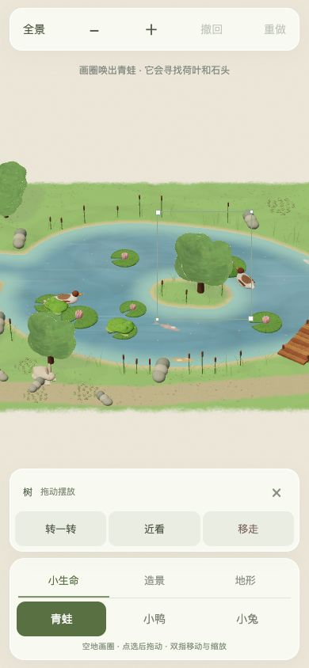
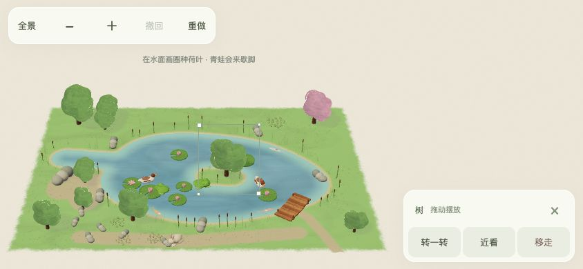

# 留白庭院 · 手机版

柔和绘画风格的庭院沙盒：画圈唤出小动物，摆放树、花、石头和荷叶，自由画出池塘与小路，观察动物对环境的反应。新物件与地形会慢慢显形。

[直接下载 ZIP](https://github.com/wentaopeng714-cmd/quiet-garden-mobile/archive/refs/heads/main.zip)

## 运行

解压后，在项目目录运行：

```sh
npm start
```

需要安装 Node.js。打开 `http://localhost:8765/`。浏览器所需的 Three.js 已包含在 `vendor/`，启动游戏无需安装依赖，也无需 API Key。

手机与电脑连接同一局域网后，用手机打开 `http://电脑局域网IP:8765/`。庭院保存在当前浏览器，不同设备和地址的存档分别保存。

## 操作

- 单指在空地画圈生成物件；点选后拖动摆放。
- 双指移动与缩放。顶部“全景 / 近景”切换取景。
- “地形”选择水面或小路，拖动绘制；水面围圈会填满，擦去可改岸线或留下小岛。
- 手机竖屏使用底部操作面板，横屏使用侧边面板。
- 支持撤回、重做和自动保存。

手机版已完成浏览器横竖屏布局和手势状态逻辑测试，尚未完成 iPhone / Android 真机性能验收。

## 测试

```sh
npm ci
npm test
```

测试覆盖画圈识别、动物轮廓与显形、环境反应、自由地形、保存与撤回、手机取景和多点触控状态。

## 预览





## 第三方依赖

Three.js 0.186.1，许可证见 [vendor/THREE-LICENSE.txt](vendor/THREE-LICENSE.txt)。
